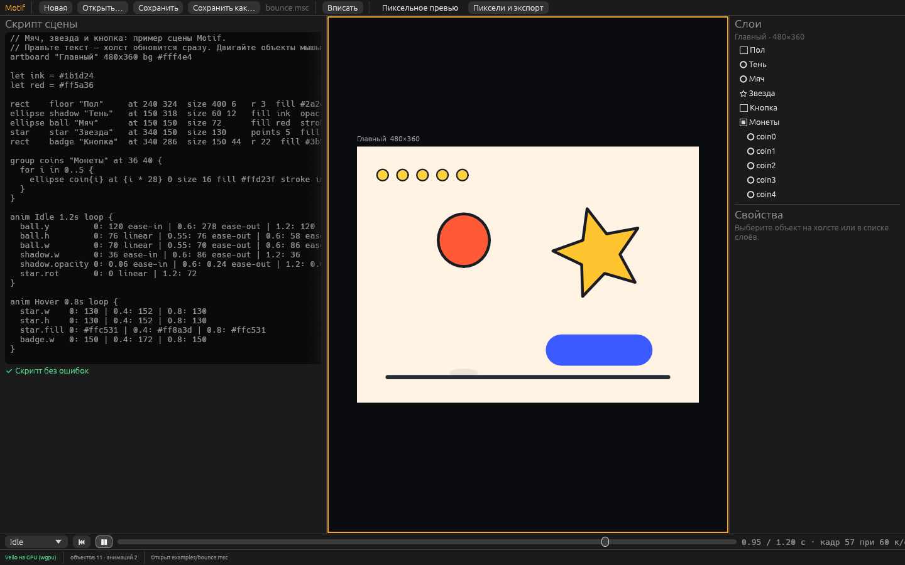

# Motif

Локальный редактор векторной анимации для игр, в духе Rive. Сцену можно написать коротким скриптом, увидеть сразу на холсте и
доделать мышью: правки с холста записываются обратно в текст скрипта.

В репозитории редактор, командная строка `motif` и аддон для Godot 4.3+. Анимации и машины состояний выгружаются в Godot
готовыми сценами со спрайтами, а узел `MotifSprite` играет сцену `.msc` прямо в игре вектором, без запекания.



Подробная документация со скриншотами лежит в [`docs/`](docs/index.html): откройте `docs/index.html` в браузере. В сборке для
Windows она в папке `docs` рядом с программой, а в редакторе открывается кнопкой «?» → «Открыть документацию».

Для персонажей доступны [параметры движения](docs/pose-parameters.html): поворот головы, моргание и рот на общих связях,
сменные кепки и раздельные режимы внешности, настройки движений и анимации. Пример — `examples/character-portrait.msc`.

Официальная документация Live2D используется как [источник принципов параметрической анимации](docs/live2d-reference.html).
Каталог содержит проверенные ссылки, соответствия с Motif и следующие шаги; параметры, опорные формы и временные ключи описаны отдельно.

## Сборка и запуск

Нужен Rust 1.95 или новее.

```sh
cargo run --release -p motif-editor -- examples/bounce.msc
```

Холст рисует [Vello](https://github.com/linebender/vello) на GPU через wgpu (на Windows это DirectX 12 или Vulkan). Если GPU
недоступен, редактор сам переходит на CPU-рендер (tiny-skia), это видно в строке состояния внизу.

На Linux нужны `libxkbcommon-x11` и драйвер Vulkan или OpenGL (подойдёт программный `mesa-vulkan-drivers`).

## Что умеет редактор

Для персонажей есть [заготовка человека сбоку](docs/characters.html): общий скелет, IK стоп, покой, ходьба, бег и прыжок.
В «Файл → Новое → Персонажи» можно создать манекен, надеть одежду путника, смешать восемь слотов и сохранить свой комплект.
«Своя копия» создаёт редактируемый вариант детали с той же привязкой к скелету.
Более сложный «Герой платформера» в стиле Марио настраивается через пропорции и палитру.
«Своя копия комплекта» копирует все надетые детали одним действием; комплект помнит выбранные параметры и цвета.

Окно устроено как в прототипе: сверху меню «Файл», переключатель Design / Animate и экспорт; слева инструменты, слои и скрипт;
в центре холст; справа свойства во всю высоту; внизу таймлайн.

* **Скрипт рядом с холстом.** Каждое изменение текста сразу перерисовывает сцену, текст подсвечивается по синтаксису. Пока в
  скрипте ошибка, на холсте остаётся последняя рабочая версия, а строка с ошибкой подсвечена красным. Клик по строке выбирает
  объект, строки выбранного объекта подсвечены. Кнопка «‹» в заголовке (или Ctrl+E) сворачивает скрипт в узкую полосу у края,
  клик по полосе разворачивает обратно. «?» рядом (или F1) открывает поверх окна шпаргалку по синтаксису.
* **Инструменты.** V — выделение, H — рука, R / O / S / N — прямоугольник, эллипс, звезда, многоугольник: тяните по холсту, и
  объект появится в скрипте перед блоками `anim`. У выделенного объекта есть ручки размера и поворота (Shift — пропорции и
  шаг 15°). Delete удаляет объект вместе с его ключами. Пока объект тянут, меняется только картинка; в скрипт и историю
  правка попадает одним шагом, когда кнопку мыши отпускают. Над ручкой поворота курсор становится круговой стрелкой.
  Кнопка с линейкой внизу панели инструментов задаёт шаг сдвига, размера и поворота (например 8 px и 15°) или свободный режим.
* **Перо и точки.** P — перо: клик ставит угловую точку, клик с протяжкой — плавную, клик по первой точке замыкает
  контур, Enter или двойной клик заканчивают открытую линию. Контур записывается в скрипт как `path … d "M … C … Z"`.
  Enter или двойной клик по контуру включают правку точек: тяните точки и ручки (ручки зеркалятся, с Alt — по
  отдельности), клик по линии добавляет точку, двойной клик по точке делает её угловой или плавной, Delete удаляет.
* **Несколько объектов.** Shift+клик или рамка по пустому месту выделяют несколько объектов: их можно тянуть вместе,
  выравнивать и распределять с равными промежутками. Ctrl+C / Ctrl+V копируют и вставляют (в буфер попадает текст
  скрипта), Ctrl+D дублирует, Ctrl+A выделяет всё, Delete удаляет. Ctrl+G группирует (объекты и их анимации остаются
  на месте, точка группы — в центре), Ctrl+Shift+G разгруппировывает, Ctrl+] / Ctrl+[ — на шаг выше или ниже соседей.
* **Свойства из веб-вёрстки.** Скругление по углам (`r 24 4 24 4`, как border-radius), наклон (`skew`, анимируется как `kx`/`ky`),
  точка вращения (`pivot`, как transform-origin), пунктир, концы и углы линии (`dash`, `cap`, `join`), тень с размытием
  (`shadow x y размытие цвет`, как box-shadow) и режимы наложения (`blend multiply` и ещё 15, как mix-blend-mode). Всё это есть
  в панели свойств: «Трансформация», «Форма», «Обводка» и «Эффекты».
* **Градиенты и маски.** В «Заливке» переключатель Цвет / Линейный / Радиальный: цвета градиента и угол правятся в панели
  и пишутся как `gradient linear 90 #a #b`. У группы галочка «Маска» (`clip`): первый объект группы обрезает остальные и
  сам не рисуется, в слоях он помечен словом «маска».
* **Слои.** Дерево объектов: группы сворачиваются, слой перетаскивается над другим, под него или внутрь группы (позиция
  пересчитывается, объект остаётся на месте). Двойной клик переименовывает, правый клик — меню: переименовать,
  заблокировать (`locked`: клики по холсту проходят сквозь объект), скрыть, удалить. Разделы панели свойств сворачиваются
  кликом по заголовку и остаются свёрнутыми для всех объектов.
* **Свойства.** Позиция, размер, угол, прозрачность, масштаб, заливка и обводка (палитра и HEX). Числа можно тянуть мышью
  прямо за подпись поля. Каждая правка меняет число в скрипте, поэтому текст и картинка всегда совпадают.
* **Палитра и пипетка.** Цвета `let main = #3b6cff` в начале скрипта — палитра: раздел «Палитра» (когда ничего не
  выделено) перекрашивает цвет на всех холстах сразу и добавляет новые. Квадраты палитры под заливкой и обводкой пишут
  имя (`fill main`), так что объект остаётся связан с палитрой. Пипетка берёт цвет с холста, как он нарисован; цвет из
  палитры записывается по имени.
* **Холсты, как в Illustrator.** В одном файле может быть несколько артбордов: каждая строка `artboard` открывает холст,
  который идёт до следующей, а всё выше первого холста (`let`-цвета, комментарии, шрифты) общее для всех — поменяли цвет
  наверху, перекрасились все холсты. Холсты стоят сеткой с зазором, каждый от левого верхнего угла своей ячейки: колонка
  шириной в самый широкий холст, ряд высотой в самый высокий. Клик по холсту открывает его (скрипт, слои и таймлайн —
  этого холста), имя над холстом тянет его в другую ячейку (холст оттуда встаёт на его место, `cell 1 0` дописывается в
  строки `artboard`), уголок справа снизу меняет размер, соседи подстраиваются. Холсты вверху панели слоёв: клик
  открывает, правый клик — копия и удаление; «Новый холст», «Копия», «Удалить», имя и размер — в правой панели, когда
  ничего не выбрано. F вписывает открытый холст, Shift+F — все. Экспорт берёт открытый холст или все сразу (см. ниже).
* **Формулы не ломаются.** Если значение задано через `let`, выражение или цикл, редактор не трогает формулу, а дописывает
  правку в блок `override { }` в конце файла. Исключение — цвет из палитры (`fill main`): выбранный вручную цвет встаёт
  на его место, и объект отвязывается от палитры.
* **Design и Animate** (переключатель сверху или Tab). В Design правки меняют значения сцены. В Animate холст обведён
  оранжевым, и любая правка ставит ключ на текущем времени прямо в блок `anim` скрипта. Ромб рядом со свойством ставит или
  снимает ключ, K ставит ключи позиции, поворота и масштаба сразу.
* **Таймлайн.** Выпадающий список анимаций (сверху — состояния машины), «+» для новой и «···» (переименовать — состояния
  машины следуют за именем, копия, обратная копия с отражёнными кривыми, удалить), пуск, «Повтор», длительность. Ниже дорожки: у каждого объекта сводка
  ключей и строки анимированных свойств. Клик по линейке или дорожке переводит время, ключ можно выбрать и сменить ему
  «Кривую» (или правым кликом по ключу), перетащить на другое время или удалить клавишей Delete. Shift+клик и рамка по пустому
  месту дорожек выбирают несколько ключей: тяните — едут все, Alt+тяните — растягиваются во времени, Ctrl+C / Ctrl+V
  копируют их на плейхед (и на другой выделенный объект), Delete удаляет. «Ключи | Графики» показывает значения свойств
  кривыми во времени: ключи тянутся по времени и значению, ручки выбранного ключа задают `cubic` прямо на графике.
  «,» и «.» — кадр назад и вперёд. Клик по миниатюре
  кривой открывает редактор кривой: две ручки Безье тянутся мышью, выше рамки — перелёт (`cubic 0.3 0 0.6 1.2`).
  «Калька» (onion skin) показывает на паузе соседние позы: красные — раньше, зелёные — позже, через 6 кадров.
  «Путь» рисует на холсте траекторию выделенного объекта: точка на каждый кадр (гуще — медленнее), кружки — ключи
  положения. Кружок тянется мышью и двигает ключ, клик по линии переводит время в эту точку пути.
  В редакторе кривой справа — библиотека: базовые кривые, все 30 функций с easings.net (sine, quad, cubic, quart, quint, expo,
  circ, back, elastic, bounce — in, out, in-out) с миниатюрами и `steps N` для покадровой анимации.
* **Подложка.** «Файл → Подложка PNG или PSD…» (или PNG/PSD, перетащенный на окно) кладёт картинку-референс под фигуры: эскиз, кадр
  из игры, макет. В панели справа, когда ничего не выделено: непрозрачность, видимость, положение и масштаб. В скрипте это
  строка `backdrop "эскиз.png" at 0 0 scale 1 opacity 0.4`; файл ищется рядом со сценой. В экспорт подложка не попадает.
  Лист спрайтов (`sheet 8 2 frames 14 fps 12`) подложка показывает по кадру: кадры с прозрачными промежутками Motif
  узнаёт сам, остальные — кнопка «Лист спрайтов». В Animate кадры идут по времени таймлайна, их удобно обводить.
  PSD (и PSB) собирается из слоёв с непрозрачностью, режимами наложения, обтравкой, масками и группами; в панели — список
  слоёв с галочками, а в скрипт пишется, что спрятано и показано вопреки файлу: `hide "Цвет" show "Сетка"`.
* **Импорт SVG.** «Файл → Импорт SVG…» (или SVG, перетащенный на окно) превращает каждую фигуру файла в `path` внутри новой
  группы по центру артборда, с заливкой, градиентом, обводкой, пунктиром и прозрачностью; большой рисунок уменьшается под
  артборд. Дырки по правилу even-odd сохраняются (`evenodd`). Текст в SVG нужно заранее перевести в кривые.
* **Направляющие, сетка, линейки.** При перетаскивании края и центры объекта прилипают к краям и центрам других объектов и
  артборда, линии совпадения подсвечиваются розовым (Alt — без прилипания). Линейки сверху и слева показывают координаты
  артборда, курсор и выделение. G — сетка поверх артборда; её шаг и кнопка «шаг = сетка» — в меню кнопки с линейкой. Там же «Пиксельная
  сетка» — пиксели картинки при масштабе экспорта, и «Шаг = пиксель экспорта», чтобы края не размывались.
* **Булевы операции.** Выделите две фигуры или больше: в панели справа «Объединить», «Вычесть» (нижняя минус верхние),
  «Пересечь» и «Исключить». Фигуры заменяются одним `path` со стилем нижней.
* **Текст.** T — текст: клик по холсту. Буквы — контуры, поэтому к тексту применяется всё, что есть у фигур: градиент,
  обводка, тень, маска. Встроенный шрифт IBM Plex Sans (обычный и жирный, латиница и кириллица) или свой TTF/OTF рядом со
  сценой. Размер и межбуквенный интервал анимируются. «Появление» (`reveal`) 0 → 1 выпускает буквы по одной с прыжком, «Фаза»
  (`phase`) двигает волну (`wave`) по тексту. «В кривые» заменяет текст контуром.
* **Слои обводки.** `outline #1b1d24 18 #fff 10` рисует под фигурой несколько обводок, широкие снизу, как у игровых
  заголовков и цифр урона. Пример — [`examples/title.msc`](examples/title.msc).
* **Размытие и глубина.** `blur 6` размывает фигуру или целую группу настоящим гауссовым размытием, тень `shadow` тоже
  мягкая по-настоящему. `elevation 12` поднимает объект над артбордом: тень сама уходит от света сцены (`light 120` в строке
  `artboard`, 90 — вниз), чем выше, тем длиннее и мягче. Всё это анимируется ключами: `blur`, `elevation`, `shadow-x`,
  `shadow-y`, `shadow-blur`. В редакторе и при экспорте картинка одна и та же. Пример — [`examples/depth.msc`](examples/depth.msc).
* **Эффекты интерфейса.** `glow 12 #ffd34d` — свечение вокруг фигуры (у фигуры без заливки светится обводка, как неон),
  `inset 0 4 6 #000000aa` — внутренняя тень, как `box-shadow: inset`, `stroke-gradient linear 90 #ffe9a8 #b56a1f` — обводка
  градиентом, `noise 0.15` — зерно поверх заливки. Размер свечения, внутренняя тень и сила шума анимируются (`glow`,
  `inset-x`, `inset-y`, `inset-blur`, `noise`): Hover может зажечь кнопку. В UI-наборе эффекты запекаются в картинки
  состояний, в экране для Godot текст с эффектами становится картинкой, а не `Label`. Пример —
  [`examples/ui-effects.msc`](examples/ui-effects.msc).
* **Символы.** `symbol Coin size=28 color=#ffd23f { … }` описывает кусок сцены один раз, `use Coin c1 at 60 44 size=40`
  ставит копию со своими местом, поворотом, масштабом и параметрами. Объекты копии получают id `c1-face` и анимируются как
  обычные; `symbol Ball clip …` делает первый объект маской каждой копии. В редакторе: «Сделать символом» у группы,
  «Вставить» в панели артборда, параметры копии в панели свойств. Пример — [`examples/symbols.msc`](examples/symbols.msc).
* **Машина состояний.** Нижняя панель переключается на «Машина состояний»: состояния (каждое играет свою анимацию)
  блоками, переходы стрелками — тянутся от точки на краю состояния. Справа входы (флаг, число, триггер), условия
  перехода, «Дождаться конца анимации» и смешивание. ▶ запускает машину на холсте, входы переключаются руками, как это
  делала бы игра. Раздел «Мышь» связывает наведение, нажатие, клик и положение указателя на объекте со входами
  (`listen button hover -> hover`); тогда «▶ Проверить» вверху превращает холст в живой предпросмотр: кнопка реагирует
  на мышь сама. «Запись» снимает прогон машины в видео. В скрипте: `machine Hero { input speed 0 … state Idle … Idle -> Run when speed > 0.5 blend 0.2s }`.
* **События анимации.** Строка «⚑ События» на таймлайне: флажки с именами (шаг, отрыв, удар) там, где игра должна об
  этом узнать. «+» или двойной клик ставят флажок, он тянется по времени, правый клик — имя и удаление. Запущенная
  машина показывает пройденные события плашками в углу графа. В скрипте: `event step 0 0.2` внутри `anim`; игра читает
  их из `MachinePlayer::events`.
  Пример — [`examples/machine.msc`](examples/machine.msc).
* **Кости и IK.** Инструмент «Кость» (B): протяжка от сустава к кончику, следующая продолжает цепочку. Объекты в блоке
  кости едут с ней; фигура с `skin upper fore` гнётся костями — контур режется на короткие кривые, и каждая точка следует
  за ближними костями (повороты смешиваются как повороты, поэтому локоть не худеет). `ik цель` сгибает цепочку так, чтобы
  кончик дотянулся до цели: 1 кость целится, 2 решаются точно, длиннее — пошагово. Пример — [`examples/bones.msc`](examples/bones.msc).
  **Веса кистью:** раздел «Веса кистью» у согнутой фигуры — тяните кистью по фигуре (Ctrl — стереть), точки показывают,
  как сильно кость тянет каждое место; рисовать можно прямо в согнутой позе. Мазки пишутся блоком
  `weights leg { hip 18 1 at -10 -78 -10 -32 }`. Пример — [`examples/weights.msc`](examples/weights.msc).
* **Морфинг.** `ellipse blob … morph star heart` и ключи `blob.morph 0: 0 | 1: 1 | 2: 2`: фигура перетекает в контуры
  других фигур по порядку. Точки контуров сопоставляются сами, острые углы остаются острыми, заливка и обводка
  смешиваются; части без пары отделяются от ближайшей (play делится на две полоски паузы). Пример —
  [`examples/morph.msc`](examples/morph.msc).
* **Пружины и покачивание.** `spring 3 0.3` у любого объекта: ключи положения, размера и поворота догоняются на пружине
  (частота в колебаниях за секунду, затухание; 1 — без перелёта). `jiggle 2.5 0.4` у кости: она отстаёт от родительской и
  раскачивается после остановки, цепочка таких костей даёт живой хвост. Работает и в машине состояний.
  Пример — [`examples/springs.msc`](examples/springs.msc).
* **Сжатие и растяжение.** `squash 0.6 6 0.3` (сила, частота, затухание): объект вытягивается по ходу движения и
  сплющивается при ударе или остановке, площадь сохраняется. Сжатие идёт от оси `pivot`.
  Пример — [`examples/squash.msc`](examples/squash.msc).
* **Частицы.** `emit 40 life 1 speed 160 angle -90 spread 50 weight 0.5 drag 0.5 fade 0 grow 0.2 spin 360`, `burst 24`:
  фигура становится источником, из неё вылетают её копии, падают, крутятся, растут и гаснут. Случайность задана номером
  частицы, поэтому кадры повторяются и запекаются в экспорт. Пример — [`examples/particles.msc`](examples/particles.msc).
* **Верёвки, цепи и ткань.** `rope 1 0.02 pin start end wind 200` делает контур верёвкой: она провисает, качается,
  ложится на препятствия, `tie` привязывает конец к объекту. `hang cord 0.5` вешает объект на верёвку (фонарь, флажки),
  `links chain` рисует фигуру звеньями цепи вдоль неё. `cloth pin left` делает из фигуры ткань: флаг, занавеска, плащ. Ткань не растягивается, сжимается плавными складками
  без выворота клеток, а на ветру полощется волнами от закреплённого края.
  Пример — [`examples/ropes.msc`](examples/ropes.msc).
* **Жидкости.** `fluid 0.1` заполняет фигуру водой: капли держат плотность, плещутся и упираются в препятствия, а рисуются
  одним гладким векторным контуром с заливкой и обводкой фигуры. `flow 60` превращает фигуру в кран, вязкость
  (`fluid 0.6`) делает мёд. Пример — [`examples/fluids.msc`](examples/fluids.msc).
* **Орбиты 2.5D.** `on planet lat 20 lon -30 alt 0 wrap`: объект лежит на шаре и ездит по нему как по глобусу, прячется за
  ним, а с `wrap` изгибается по поверхности. `yaw` и `pitch` у шара поворачивают всё, что на нём: так поворачивается голова.
  Пример — [`examples/orbit.msc`](examples/orbit.msc).
* **Стороны для вида сверху.** `directions 8 turn body mirror` снимает персонажа с 8 сторон: объекты из `turn` (шары и
  3D-тела) поворачиваются на каждую сторону, и всё, что стоит на них, уезжает вбок и за спину само. `mirror` не рисует
  левые стороны: в игре это отражённые правые. Анимация `Walk_up` заменяет `Walk` только для вида со спины. В редакторе —
  раздел «Стороны» с компасом вида на холсте, в Godot — все стороны в одном атласе и `facing` в скрипте сцены, в командной
  строке — `--side up_right`. Пример — [`examples/directions.msc`](examples/directions.msc).
* **3D-тела.** `extrude 90` выдавливает любую фигуру в глубину (квадрат — куб, круг — цилиндр, звезда — печенье,
  контур с дыркой — кольцо), `extrude 120 0` сужает заднюю грань в конус или пирамиду. `yaw` и `pitch` поворачивают тело
  в пространстве, грани освещает свет сцены, гладкие стенки закрашиваются плавно, обводка идёт только по рёбрам. Всё
  остаётся вектором и анимируется ключами (`depth`, `taper`, `yaw`, `pitch`). Пример — [`examples/bodies.msc`](examples/bodies.msc).
* **Процедурные кисти.** `rough 3 40` — контур гуляет «от руки», `boil 8` — линия перерисовывается 8 раз в секунду, как в
  рисованной анимации, `hatch 45 6 1.5 #2a2230 cross` — штриховка, `grain 0.15 2` — зерно, `bands 3` — градиенты и свет
  на 3D-телах ступенями, `seed 2` — другой рисунок той же кисти. Всё остаётся вектором и считается из семени, поэтому
  сцена рисуется одинаково при каждом экспорте. В редакторе — раздел «Кисть». Пример — [`examples/brushes.msc`](examples/brushes.msc).
* **Физика на шаре.** `on globe … roll 0.3 0.05`: объект сам катится по шару к его нижнему полюсу, крутится на ходу и
  толкает соседей; наклон шара (`pitch`) катит всё в другую сторону, а сцепление решает, увлекает ли его вращающийся шар.
  Пример — [`examples/rolling.msc`](examples/rolling.msc).
* **Гравитация и ветер.** `world gravity 0 900 wind 200 0 gust 0.4` задаёт, куда всё падает и куда дует ветер с порывами:
  этого слушаются частицы, мягкие тела, верёвки, ткань, вода и то, что катится по шару. У объекта `weight` (вес, 0 —
  невесомый) и `sail` (сколько ветра ловит). Мир анимируется ключами: `world.wind-x 0: 0 | 2: 600`. Пример —
  [`examples/world.msc`](examples/world.msc).
* **Притяжение и вентиляторы.** `pull 2600 range 200` делает объект точкой притяжения (с минусом — отталкивает),
  `fan 600 range 300 cone 40` — вентилятором, который дует туда, куда объект повёрнут. Силу можно анимировать ключами:
  чёрная дыра, взрывная волна, шарик над вентилятором. Пример — [`examples/fields.msc`](examples/fields.msc).
* **Мягкие тела.** `soft 0.2 pressure 1 friction 0.3 drive 0.4 weight 1` делает контур фигуры упругим кольцом: оно держит
  форму и площадь, препятствия (`solid`) его сжимают, ключи положения тянут. Расчёт идёт от начала анимации фиксированными
  шагами, кадры кэшируются, экспорт запекает результат. Тела сталкиваются и с препятствиями, и друг с другом:
  контур обтекает углы и пики, а не протыкается ими. Примеры — [`examples/tunnel.msc`](examples/tunnel.msc),
  [`examples/jelly.msc`](examples/jelly.msc).
* **Пиксельное превью.** Кнопка «Пиксели» рендерит сцену без сглаживания в заданную ширину и приводит её к палитре сцены
  или к загруженной `.pal`. Так видно, что получится после пикселизации, ещё до экспорта.
* **Экспорт** кадров PNG и палитры `.pal` (кнопка «Экспорт»). В файле с несколькими холстами вверху окна выбор
  «Открытый холст / Все»: со всеми каждый холст сохраняется кадрами `ХОЛСТ_0000.png`, палитра собирает цвета всех.
* **SVG и web-пакеты** — «Экспорт → SVG холста… / Web-пакет…» ([docs/web.html](docs/web.html)). Русские имена слоёв и холстов
  транслитерируются в id и имена файлов (`Нужда: еда` → `Nuzhda-eda.svg`), само имя остаётся в `data-name`. Своё латинское
  имя слоя — поле «Имя для экспорта» на панели «Свойства».
* Открытие и сохранение `.msc`, отмена и повтор (Ctrl+Z, Ctrl+Shift+Z / Ctrl+Y), «Вписать» (F). Если файл поменяли в другой
  программе, редактор перечитает его сам, когда в нём нет несохранённых правок. Все клавиши — по кнопке «?».

## Сборка для Windows и обновление

Каждый коммит в `main` собирает Windows-версию и публикует её как последний
[релиз](https://github.com/Taimurodo-RT/vector_for_games/releases/latest) (`Motif-windows-x64.zip`). В папке сборки лежит
`update.bat`: он сравнивает `version.txt` с последним релизом, просит закрыть редактор, если тот открыт, и заменяет программу.
Свои сцены и изменённые примеры остаются на месте. То же самое запускает пункт «Файл → Проверить обновления…».
Файлы сборки и скрипт обновления лежат в [`packaging/windows`](packaging/windows).

## Скрипт сцены (`.msc`)

Одна строка — один объект: `тип id ["Имя"] свойства…`. Вложенность задаётся фигурными скобками.

Первая строка файла — версия формата `motif 1`. Motif пишет её сам при сохранении; файл без неё открывается как
версия 1. Файлы прошлых форматов, которые обязаны открываться всегда, — в [`tests/old-formats/`](tests/old-formats).

Входы и состояния машин, анимации, события и параметры позы носят скрытый id в конце строки (`input speed 0 id=k7f2`).
Motif дописывает его сам при сохранении и сохраняет при переименовании, поэтому привязки в игре (Forge) не рвутся, когда
`speed` становится `скорость`. Подробнее — [docs/script.html](docs/script.html).

```text
motif 1
artboard "Главный" 480x360 bg #fff4e4

let ink = #1b1d24

ellipse ball "Мяч"  at 150 150  size 72  fill #ff5a36  stroke ink 4
star    star        at 340 150  size 130 points 5  fill #ffc531

group coins at 36 40 {
  for i in 0..5 {
    ellipse coin{i} at {i * 28} 0 size 16 fill #ffd23f
  }
}

anim Idle 1.2s loop {
  ball.y   0: 120 ease-in | 0.6: 278 ease-out | 1.2: 120
  star.rot 0: 0 linear | 1.2: 72
}
```

| Что | Запись |
| --- | --- |
| Типы | `rect`, `ellipse`, `star`, `polygon`, `path`, `text`, `group` |
| Текст | `content "Привет\nмир"`, `font bold` / `font "шрифт.ttf"`, `font-size 48`, `letter-spacing 2`, `line-height 1.2`, `align left\|center\|right` |
| Анимация букв | `reveal 0.5` (доля появившихся букв), `wave 6` (высота волны), `phase 0.25` (положение волны) |
| Обводки слоями | `outline #1b1d24 18 #ffffff 10` |
| Позиция центра | `at x y` |
| Размер | `size w [h]` |
| Скругление (одно или по углам), лучи, внутренний радиус звезды | `r 8` / `r 8 8 0 0`, `points 5`, `inner 0.5` |
| Контур (SVG path data, вокруг `at`) | `d "M 0 -20 C 15 -20 20 0 0 20 L -10 0 Z"` |
| Поворот (градусы), масштаб, наклон, прозрачность | `rot 15`, `scale 1.2 [0.8]`, `skew 10 [0]`, `opacity 0.5` |
| Точка вращения (transform-origin) | `pivot -30 0` |
| Заливка и обводка | `fill #ff5a36` / `fill none`, `stroke #000 2` |
| Градиент (вместо заливки) | `gradient linear 90 #ffe7a3 #ff9d5c`, `gradient radial #fff #3b5bff #000` |
| Пунктир, концы, углы линии | `dash 6 4`, `cap butt\|round\|square`, `join miter\|round\|bevel` |
| Тень (размытие можно опустить) | `shadow 0 4 8 #00000055`, `shadow 4 4 #000` |
| Внутренняя тень | `inset 0 4 6 #000000aa` |
| Свечение: размер, [разлив], цвет | `glow 12 #ffd34d`, `glow 16 4 #6f93ffcc` |
| Градиентная обводка | `stroke-gradient linear 90 #ffe9a8 #b56a1f` |
| Шум: сила 0…1, [крупинка] | `noise 0.15`, `noise 0.2 2` |
| Размытие объекта или группы | `blur 6` |
| Высота над артбордом (тень от света) | `elevation 12`; свет сцены: `artboard "Имя" 480x300 light 120` |
| Наложение | `blend multiply`, `screen`, `overlay`, `darken`, `lighten`, `color-dodge`, `color-burn`, `hard-light`, `soft-light`, `difference`, `exclusion`, `hue`, `saturation`, `color`, `luminosity` |
| Маска у группы | `group окно clip { ellipse форма … остальное … }` |
| Скрыть | `hidden` |
| Дырки по правилу even-odd | `evenodd` |
| Ещё холст (до следующего `artboard`), место в сетке | `artboard "Кнопка" 240x100 cell 1 0` |
| Подложка (только в редакторе) | `backdrop "эскиз.png" [at x y] [scale 0.5] [opacity 0.4] [hidden]` |
| Подложка — лист спрайтов | `backdrop "run.png" sheet 8 2 [frames 14] [fps 12] [frame 3]` |
| Подложка — слои PSD | `backdrop "герой.psd" [hide "Цвет" "Заметки"] [show "Сетка"]` |
| Переменные и выражения | `let gap = 28`, `{i * gap + 4}` в значениях и id |
| Циклы | `for i in 0..5 { … }` |
| Анимация | `anim Имя 1.2s [loop] { объект.свойство время: значение [кривая] \| … }` |
| Кривые | `linear`, `ease`, `ease-in`, `ease-out`, `ease-in-out` (по умолчанию), `hold`, `spring`, `steps 4`, `cubic x1 y1 x2 y2` |
| Кривые easings.net | `ease-in-sine` … `ease-in-out-bounce`: sine, quad, cubic, quart, quint, expo, circ, back, elastic, bounce |
| Ручные правки поверх формул | `override { coin2.y = 12 }` |
| Комментарии | `// …` или `#` в начале строки |

В анимации и `override` свойства пишутся так: `x y w h rot sx sy kx ky opacity r points inner fill stroke stroke_w`,
у текста ещё `font-size letter-spacing reveal wave phase`.

Полные примеры — [`examples/bounce.msc`](examples/bounce.msc) , [`examples/gem.msc`](examples/gem.msc) (градиенты и маска) и
[`examples/card.msc`](examples/card.msc) (тень, пунктир, наложение, наклон и точка вращения).

## Командная строка `motif`

Те же сцены можно проверять и рендерить без окна, например в скриптах сборки игры:

```sh
cargo run --release -p motif-cli -- check  examples/bounce.msc
cargo run --release -p motif-cli -- render examples/bounce.msc -o ball.png --scale 2
cargo run --release -p motif-cli -- frames examples/bounce.msc --anim Idle --fps 12 --width 120 --no-aa -o out/idle
cargo run --release -p motif-cli -- video   examples/bounce.msc --anim Idle --scale 2 -o out/idle.mp4
cargo run --release -p motif-cli -- palette examples/bounce.msc -o out/scene.pal
cargo run --release -p motif-cli -- pixel   examples/bounce.msc --anim Idle --preset my.preset --no-aa -o out/idle_px
cargo run --release -p motif-cli -- kit     examples/ui-kit.msc --scale 2 -o out/ui
cargo run --release -p motif-cli -- screen  examples/menu.msc -o out/menu
cargo run --release -p motif-cli -- godot   examples/machine.msc --node hero --pivot 240 238 -o out/hero
cargo run --release -p motif-cli -- runtime examples/machine.msc -o ~/game/characters
cargo run --release -p motif-cli -- contract examples/machine.msc -o out/machine.contract.json
cargo run --release -p motif-cli -- godot   examples/directions.msc -o out/walker
cargo run --release -p motif-cli -- render  examples/directions.msc --anim Walk --side up_right -o out/up_right.png
cargo run --release -p motif-cli -- render  examples/ui-kit.msc --board Кнопки -o out/buttons.png
```

В файле с несколькими холстами `--board ИМЯ` (или номер с 1) берёт один, без него команды работают со всеми: `check`
перечисляет холсты, `render` сохраняет `СЦЕНА_ХОЛСТ.png` (`-o` — папка), `kit` собирает детали всех холстов в одну тему,
`godot` выгружает каждый холст своей сценой `ХОЛСТ.tscn`, `palette` собирает цвета всех холстов, `frames`, `pixel`
и `video` берут холст, где есть анимация `--anim`.

`contract` пишет договор сцены для игры (Forge) в JSON: холсты, анимации с длиной, повтором и событиями, машины с
состояниями, входами и связями с мышью, параметры позы, имена событий, стороны; у входов, состояний, анимаций, событий и
параметров — их скрытые id. В Rust — `motif_script::contract`.
У каждого примера в `examples/` лежит образец `ИМЯ.contract.json`, тест сверяет с ним договор (после намеренной
правки: `MOTIF_BLESS=1 cargo test -p motif-script --test contracts`). Подробнее —
[docs/export.html#contract](docs/export.html#contract).

## Видео

«Экспорт → Видео» (или `motif video`) сохраняет анимацию одним файлом, формат — по расширению: GIF и APNG (`.png`)
Motif пишет сам, MP4 (H.264) и WebM (VP9, с прозрачностью) — через [ffmpeg](https://ffmpeg.org/download.html), который
ищется рядом с Motif, в `PATH` или по пути из окна экспорта (`--ffmpeg` в командной строке). Повторяющаяся анимация в
GIF и APNG крутится по кругу без шва, а где прозрачности нет (MP4), её место занимает цвет фона холста. Пока видео
пишется, внизу окна видно «Кадр N из M» и «Отменить» (недописанный файл удаляется), а готовый файл показывает
«Открыть папку».

Целый прогон машины состояний — с переходами, смешиванием и событиями — снимает кнопка «Запись» на панели машины:
она запоминает, как менялись входы, а «Стоп» проигрывает прогон заново кадр за кадром и сохраняет видео. Из командной
строки прогон пишется словами: `motif video hero.msc --machine Hero --take "0.5 speed=1, 2 jump, 3.5 speed=0" --length 5 -o run.gif`.

## Анимации в Godot

«Экспорт → Выгрузить в Godot…» (или `motif godot`) переносит персонажа в проект Godot целиком:

* `ИМЯ.png` — атлас всех кадров всех анимаций. Кадры одного размера (коробка вокруг каждой позы, спрайт не прыгает),
  одинаковые кадры хранятся один раз.
* `ИМЯ_frames.tres` — `SpriteFrames` с анимациями из Motif, их скоростью и повтором.
* `ИМЯ.tscn` — готовая сцена: `Node2D` и `AnimatedSprite2D`, точка привязки — центр выделенного объекта (или
  `--pivot X Y`).
* С машиной состояний — ещё `AnimationPlayer`, `AnimationTree` с теми же состояниями и переходами (условия становятся
  выражениями, `any` — переходами из каждого состояния, «в конце» — переходом по окончании) и скрипт `ИМЯ.gd`, где входы
  машины — переменные: `hero.speed = 1.0`, `hero.fire_jump()`. Проверено в Godot 4.3: капля из `machine.msc` бегает,
  прыгает и возвращается так же, как в редакторе. Подробнее — [docs/export.html#godot](docs/export.html#godot).
* События анимаций приходят сигналом корня сцены: `hero.event.connect(func(name): …)` — `step` на каждом шаге бега,
  `land` при приземлении.
* После первой выгрузки сцена запоминает папку Godot: каждое Ctrl+S выгружает её туда снова, Godot подхватывает
  изменения сам. «Отвязать» в окне «Экспорт» это выключает.
* Файл с несколькими холстами: «Открытый холст» выгружает один холст сценой `ХОЛСТ.tscn` (и запоминает его по имени,
  так что Ctrl+S обновляет его, какой бы холст ни был открыт), «Все» — каждый холст своей сценой в одну папку.
  Через PixaTool — по одному холсту за раз.
* Флажок «Через PixaTool» (или `--pixelize` / `--preset X.preset`) прогоняет кадры через PixaTool перед упаковкой: в
  атлас ложится пиксель-арт в размере пикселей пресета, с фильтром Nearest и сдвигом на целых пикселях. Подробнее —
  [docs/export.html#godot-pixatool](docs/export.html#godot-pixatool).

## Motif в игре: MotifSprite

Аддон `godot-addon/addons/motif` (GDExtension на Rust, Godot 4.3+) добавляет узел `MotifSprite`. Он читает `.msc` и играет
его в игре тем же ядром, что и редактор: кости, мягкие тела, морфинг, 3D, машина состояний и события работают как в
Motif, а кадр рисуется под размер узла на экране и остаётся чётким при приближении камеры.

* «Экспорт → Поставить в проект Godot…» (или `motif runtime сцена.msc -o папка-в-проекте`) ставит аддон в
  `addons/motif`, кладёт `.msc` со шрифтами и `ИМЯ.tscn` с готовым узлом, дописывает `*.msc` в фильтры экспорта.
  Потом каждое Ctrl+S копирует сцену в проект снова. Установка — всё или ничего: проект старше Godot 4.3 или
  чужой шрифт отказываются до изменений, а сбой посреди замены (открытый Godot держит DLL) возвращает прежний
  аддон, сцену и шрифты. Свои файлы проекта и `ИМЯ.tscn` с правками не трогаются; отчёт говорит, что изменилось,
  включая сборку аддона (`addons/motif/version.txt`).
* Свойства: `scene` (файл), `board`, `machine` или `animation`, `playing`, `speed`, `centered`, `resolution`,
  `background`, `pointer` (мышь для строк `listen`), `gpu` (рисовать на видеокарте; выключенное — весь кадр на
  процессоре, пиксель в пиксель как в Motif).
* Из кода: `set_input("speed", 1)`, `fire("jump")`, `get_state()`, `jump_to("Hit")`, `restart()`, `get_image(2.0)`,
  `advance(0.1)`; сигналы `event(name)` и `state_changed(state)`.
* Стороны (`directions`): `facing = dir` показывает ближайшую сторону, состояние играет `Walk_up` вместо `Walk`, шаг
  продолжается с того же места и поворот не шлёт событий; левые стороны с `mirror` отражаются при рисовании, сам узел
  не переворачивается. Ещё `side = "up_right"`, `get_sides()`, `is_flipped()` и сигнал `side_changed(side)`.
* Как это устроено и почему GDExtension, а не GDScript — [docs/runtime.html#how](docs/runtime.html#how).
* Сам проигрыватель — крейт `motif-runtime` без Godot и без окна: его подключают Forge и другие игры на Rust
  (`Player::load`, `set`, `fire`, `advance(dt)`, `render`), время он получает только от игры —
  [docs/runtime.html#library](docs/runtime.html#library). Машина и физика идут целыми шагами по 1/60 с, так что
  игра одинакова при любой частоте кадров; `advance` возвращает все события по порядку с точным временем,
  `advance(0)` ничего не меняет, `set_seed` задаёт случайность частиц, жидкостей и «рисованных» линий —
  [docs/runtime.html#determinism](docs/runtime.html#determinism).
* Скорость: контуры уходят на видеокарту треугольниками (размытие, тени, маски, градиенты пока рисуются на процессоре
  маленькими картинками), фигуры в сетках-деформерах режутся один раз, а гнёт их точки сама сетка, кадры всех узлов готовятся одновременно на всех ядрах, а неизменная поза не готовится заново. Замер в
  настоящем Godot — `godot-addon/test/bench/run.sh ГОДОТ БИБЛИОТЕКА [N…]` (среднее и p95 работы кадра, память); цифры
  и советы — [docs/runtime.html#speed](docs/runtime.html#speed).
* В сборке для Windows аддон лежит в `godot-addon/` вместе с `bin/motif_godot.dll`; для Linux и macOS библиотеку
  собирает `cargo build --release -p motif-godot`. Пример — `godot-apps/hero`, проверка в настоящем Godot —
  `godot-addon/test/run.sh`. Подробнее — [docs/runtime.html](docs/runtime.html).
* Путь до игры целиком проверяет `godot-addon/test/e2e/e2e.sh`: установка, правка `.tscn` человеком, переустановка,
  экспорт шаблонами 4.3 и запуск игры из чужой папки с автотестом (код 0). CI гоняет его на Linux и на собранном
  `game.exe` для Windows; проверка руками на своём ПК — [docs/runtime.html#delivery](docs/runtime.html#delivery).

## UI-наборы для Godot

«Файл → Новое…» (Ctrl+N) открывает поверх редактора библиотеку шаблонов с картинками: пустая сцена, UI-набор и
одиннадцать экранов игры из [`examples/screens`](examples/screens) — главное меню, пауза, настройки, HUD, диалог,
инвентарь, магазин, победа, поражение, выбор уровня, загрузка. Экраны собраны на стеках и привязках с деталями `ui`,
поэтому `motif screen` сразу делает из них сцены Godot, а раскладка держится при любом размере окна.

Интерфейс игры рисуется в Motif обычными фигурами и уходит в Godot готовой темой. «Файл → Новый UI-набор» открывает
заготовку ([`examples/ui-kit.msc`](examples/ui-kit.msc)) из семи холстов: кнопки (основная, вторичная, опасная, успех,
контурная, прозрачная, маленькая, круглые со значками), переключатели (флажок, тумблер `ui switch`, радио-кнопки
`ui check radio difficulty`), поля (ввод `ui input`, поиск, выпадающий список `ui option`, счётчик), полосы (здоровье,
мана, опыт, слайдер, прокрутка, рейтинг и круговая загрузка), панели (карточка, окно, уведомление, слоты, подсказка,
значки, клавиша), навигация (вкладки, точки страниц) и текст — с общими цветами в начале файла. «Экспорт → Холсты: Все → Сохранить
UI-набор…» (или `motif kit`) собирает детали всех холстов в одну тему; одинаковые id с разных холстов получают номер
(`knob_2`).

* Режим UI (`artboard … ui`, переключатель «Всё / UI / Игра» сверху): раздел «Интерфейс» и экспорт UI-набора на виду,
  кости, физика, 3D, орбиты, кисти, мир и свет спрятаны; «Добавить состояния Hover и Press» заводит анимации состояний.
  Режим «Игра» (`game`) прячет раздел «Интерфейс». Новая сцена открывается в «Игре», новый UI-набор — в UI.
* `ui` помечает объект или группу как деталь интерфейса, `slice 20` (или `slice 16 12`, `slice 22 46 22 22`) — поля
  9-slice, которые не растягиваются. В редакторе это раздел «Интерфейс», поля видны на холсте розовым пунктиром.
* Состояния — анимации `Hover`, `Press`, `Disabled`, `Focus`: каждое состояние — последний кадр анимации.
* «▶ Проверить» вверху оживляет детали `ui` на холсте без настройки, как в Godot: кнопки играют Hover и Press,
  флажки щёлкаются, слайдеры и прокрутка тянутся мышью. Справа панель «Проверка» с состоянием и значением каждой
  детали; там же значение полосы и «Недоступно». Одинаково нарисованные детали ведут себя как анимированная.
* Необычные слайдеры: `ui slider` без дорожки и ползунка, который рисует анимация `Value` (начало — 0, конец — 1).
  Значение проигрывает её, Hover и Press работают поверх. `dial across|up|turn 270` — как тянуть мышью (без него — по
  форме), `value 0.4` — где стоит. В Godot это `Range` со скриптом `motif_dial.gd` и кадрами `ID_dial.png`.
  Пример — [`examples/dials.msc`](examples/dials.msc).
* «Проверить растяжение…» в разделе «Интерфейс» показывает деталь так, как её растянет Godot, из картинок темы:
  тяните уголок, наводите и нажимайте мышью (Hover, Press), двигайте значение полосы и слайдера, 1x/2x/3x без
  сглаживания. Ниже — проверка краёв: фигуры с краями между пикселями экспорта выйдут размытыми, «Выровнять по
  пикселям» ставит заливку и обводку на целые пиксели (нечётная обводка — край на половине пикселя).
* Слово после `ui` — тип в Godot: `ui button`, `panel`, `progress` (ProgressBar), `check` (CheckBox), `slider`
  (HSlider/VSlider), `scroll` (H/VScrollBar), `label` (Label). Детали внутри помечаются `part`: `part background` и
  `part fill` у полосы, `part unchecked`/`checked` у флажка, `part track`/`grabber` у слайдера и прокрутки. Подпись
  `part text` не запекается: в тему уходят шрифт (файл кладётся рядом), размер и цвет текста в каждом состоянии.
* Авто-раскладка (раздел «Раскладка»): `stack row|column [start|center|end] gap 10 pad 18` у группы выстраивает детей,
  как flex; `fit` у ребёнка делает его фоном во весь стек; `anchor right bottom` считает `at` от края артборда, так что
  кнопка «закрыть» остаётся в углу при любом размере. Стек пересчитывается каждый кадр, и выросшая в анимации кнопка
  раздвигает соседей. Пример — [`examples/menu.msc`](examples/menu.msc).
* Пример точного повтора веб-кнопки по её CSS — [`examples/modern-button.msc`](examples/modern-button.msc): размеры,
  кривая `cubic-bezier(0.23, 1, 0.32, 1)`, разные длительности свойств, `overflow: hidden` маской, кольцо из
  `box-shadow`, машина состояний hover/press. Шрифт Inter лежит в `examples/fonts` (лицензия OFL).
* «Экспорт → Сохранить UI-набор…» (или `motif kit`) пишет PNG по деталям и состояниям, шрифты подписей и тему
  `.tres`: каждая деталь — вариация своего типа Godot со `StyleBoxTexture` и полями 9-slice. Тени и
  обводки за рамкой детали уходят в `expand_margin`, поэтому кнопка в Godot остаётся своего размера. Тема проверена в
  Godot 4.3. Подробнее — [docs/export.html#ui-kit](docs/export.html#ui-kit).
* «Экспорт → Экран для Godot…» (или `motif screen`) делает из холста сцену `ХОЛСТ.tscn` из `Control`-узлов: детали
  `ui` — кнопки, полосы и флажки своих типов с вариациями из темы (значения и галочки — как нарисованы), стеки —
  `VBoxContainer`/`HBoxContainer` в `PanelContainer` с фоном 9-slice, привязки — якоря, тексты — `Label`, остальное —
  картинки `TextureRect`. Тема пишется рядом и назначена корню; меню из `examples/menu.msc` в Godot 4.3 совпадает
  с холстом до пикселя. Подробнее — [docs/export.html#screens](docs/export.html#screens).
* `godot-apps/` — приложения Godot с интерфейсом из Motif: калькулятор и таймер «Фокус» (а ещё `hero` — капля,
  которая играет вектором через `MotifSprite`). Рисунок в `ИМЯ.msc`,
  `motif screen` собирает из него `ui/`, а `main.gd` — только логика по id узлов. Одинаково нарисованные клавиши
  становятся одним типом темы. Подробнее — [godot-apps/README.md](godot-apps/README.md).

## Пикселизация: PixaTool

Motif сам управляет PixaTool 1.58: запускает его вне экрана, загружает пресет, прогоняет кадры анимации и забирает
результат. Файлы PixaTool не меняются, а запускается он со своим профилем, поэтому ручная копия не затрагивается.

* **В редакторе.** «Экспорт → PixaTool»: Pixatool.exe находится сам в папке `tools` рядом с Motif или выше (его можно
  указать и вручную), пресет — файл из кнопки «Save Preset» в PixaTool. «Пикселизировать кадры…» пишет `ИМЯ_0000.png…`
  в выбранную папку; ход работы виден в окне и в строке состояния. Пути запоминаются в `motif.ini` рядом с программой.
* **Из командной строки.** `motif pixel сцена.msc --anim Idle --preset пиксель4.preset --no-aa -o out/idle`.
  PixaTool ищется в `--pixatool`, в переменной `MOTIF_PIXATOOL` и в папке `tools`.
* **Палитра.** `palette` сохраняет цвета сцены в JASC `.pal` (не больше 192 цветов, это предел PixaTool): её можно
  загрузить в PixaTool и сохранить в пресет. **Pixel FX Designer** читает те же `.pal`.
* **Превью в редакторе.** Кнопка «Пиксели» показывает сцену в целевом разрешении и палитре, поэтому размеры и толщину
  линий удобно подбирать до экспорта.
* Ручной путь тоже остаётся: `frames` складывает кадры, а «Batch Images» в PixaTool обрабатывает их пакетом.

Проверка моста на настоящем PixaTool: `MOTIF_TEST_PIXATOOL=путь/к/Pixatool cargo test -p motif-pixel -p motif-editor`.

## Устройство

| Крейт | Что делает |
| --- | --- |
| `motif-core` | Модель сцены: объекты, трансформации, цвета, анимации и кривые |
| `motif-script` | Лексер, парсер и вычислитель `.msc`; запись визуальных правок обратно в текст |
| `motif-render` | Список отрисовки, CPU-рендер (tiny-skia), сцена Vello (`gpu`) |
| `motif-pixel` | Палитры JASC, квантование, рендер кадров анимации, управление PixaTool |
| `motif-runtime` | Проигрыватель сцены в игре без движка и окна: машина, входы, стороны, события, кадр (для Forge и Godot) |
| `motif-godot` | Аддон Godot 4: узел MotifSprite на `motif-runtime` |
| `motif-web` | Выгрузка в SVG/HTML/CSS |
| `motif-cli` | Команда `motif` |
| `motif-editor` | Окно редактора (eframe/egui + Vello), шрифты IBM Plex (OFL) |

```sh
cargo test --workspace
```

Параметрические сочетания и корректирующие формы: [инструкция](docs/parameter-combinations.html). Короткие HTML/CSS-фрагменты преобразуются в редактируемый UI: [импорт](docs/html-css-import.html).
