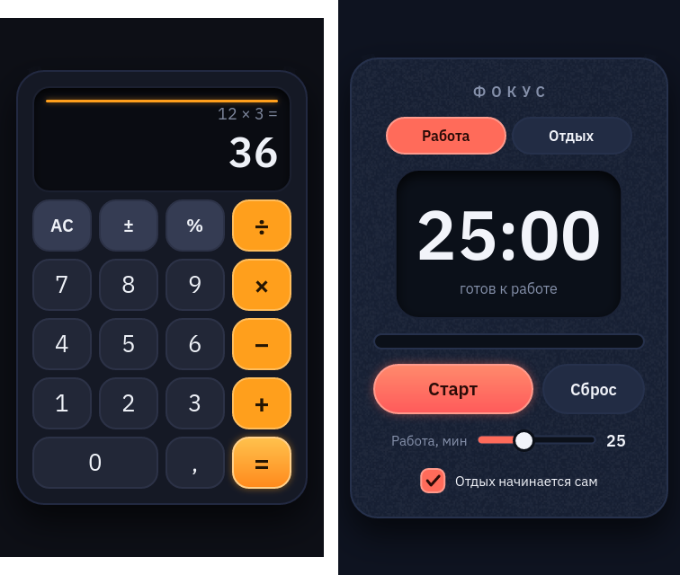

# Приложения Godot с интерфейсом из Motif

Два маленьких проекта Godot 4, у которых весь интерфейс нарисован в Motif, а в Godot написана только логика.

| Папка | Что это |
|---|---|
| `calculator` | Калькулятор: табло со светящейся полоской, клавиши с наведением и нажатием, ввод с клавиатуры. |
| `focus` | Таймер «Фокус» (помидор): режимы «Работа/Отдых», большие часы, полоса прогресса, слайдер минут, флажок «Отдых начинается сам». |

## Как запустить

Откройте `calculator/project.godot` или `focus/project.godot` в Godot 4.3 или новее и нажмите F5.

## Как устроено

* `app.msc` — интерфейс: его можно открыть в редакторе Motif, перекрасить, переставить, поменять анимации наведения.
* `ui/` — что из него сделал `motif screen`: сцена `app_screen.tscn` из узлов `Control`, тема `.tres`, картинки
  состояний и шрифты. Эту папку не правят руками, она пересобирается.
* `main.tscn` — корень приложения: в нём экземпляр `ui/app_screen.tscn` с именем `UI` и скрипт `main.gd`.
* `main.gd` находит узлы по id из скрипта Motif (`ui.find_child("keq")`) и подключает сигналы. Поэтому после
  правки рисунка код не меняется, пока id те же.

Клавиши, нарисованные одинаково, в теме становятся одним типом: у калькулятора анимированы только `k7`, `k0`, `kac`,
`kdiv` и `keq`, а остальные клавиши получают их состояния.

## Как пересобрать интерфейс после правки .msc

* Windows: `build.bat`. `motif.exe` берётся из переменной `MOTIF`, из папки Motif уровнем выше или из `PATH`.
* Linux/macOS: `./build.sh` (без `motif` в `PATH` собирает его `cargo` из этого репозитория).

Шрифты IBM Plex Sans, которые `motif screen` кладёт в `ui/`, распространяются по лицензии OFL (`fonts-OFL.txt`).
